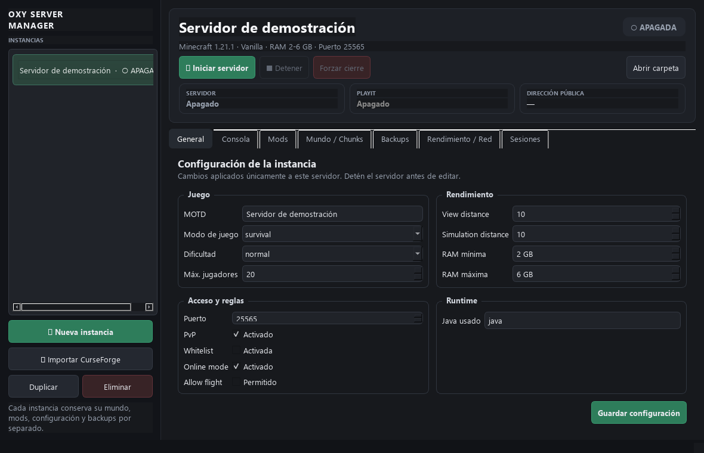

# Oxy · aplicaciones y soluciones por encargo

Soy Alberto Jasso. Creo herramientas para Windows y web a partir de problemas que encuentro en mi uso diario: administrar servidores, controlar la PC desde el celular y organizar tareas.

Este portafolio presenta dos proyectos personales, sus funciones actuales y ejemplos de servicios que puedo adaptar por encargo. Los proyectos se desarrollan con asistencia de IA; las demostraciones distinguen lo disponible de lo que aún requiere pruebas.

## Oxy Server Manager

**Un panel para organizar servidores de Minecraft en Windows.** Cada instancia conserva su configuración, mundo, mods y respaldos separados.

- Configuración de Java, memoria e instancias.
- Importación de Server Packs de CurseForge y administración de mods.
- Backups, restauración protegida y pregeneración de zonas con Chunky.
- Paneles de rendimiento e historial de sesiones.

**Servicio por encargo:** preparar una instancia, configurar un modpack compatible, comprobar su funcionamiento y entregar instrucciones de respaldo. El alcance y la cotización se acuerdan antes de comenzar.

[Ver demostración y alcance](oxy-server-manager.md).

## Pocket Deck

**Botones en el celular para abrir programas, carpetas y enlaces en Windows.** Nueve botones por panel, con carpetas y editor visual.

- PWA para el celular y aplicación de bandeja en Windows.
- Vinculación con código y comunicación dentro de la red local.
- Botones y carpetas configurables, con respaldo de la configuración.
- Actualizaciones de la PWA que conservan la vinculación y los botones.

[Abrir demo de la interfaz](https://pocket-deck-oxy.albertovj6969.chatgpt.site/) · [Ver funcionamiento y alcance](pocket-deck.md).

La demo pública muestra la interfaz. Para ejecutar acciones hace falta el programa de Windows y un celular compatible en la misma red.

**Servicio por encargo:** configurar un panel personalizado para las herramientas de una PC y entregar una guía breve de uso. La compatibilidad del dispositivo se comprueba antes de acordar el trabajo.

## Consultas

Puedes [abrir una consulta en este repositorio](https://github.com/AlbertoVJ/oxy-portfolio/issues/new) indicando el proyecto, el resultado que buscas y tu sistema operativo. No incluyas contraseñas, códigos de vinculación ni datos personales en una consulta pública.

Este repositorio contiene presentaciones y capturas. Las demos no incluyen credenciales, configuraciones personales, mundos ni código de las aplicaciones. No incluye un instalador público de las apps de Windows.
