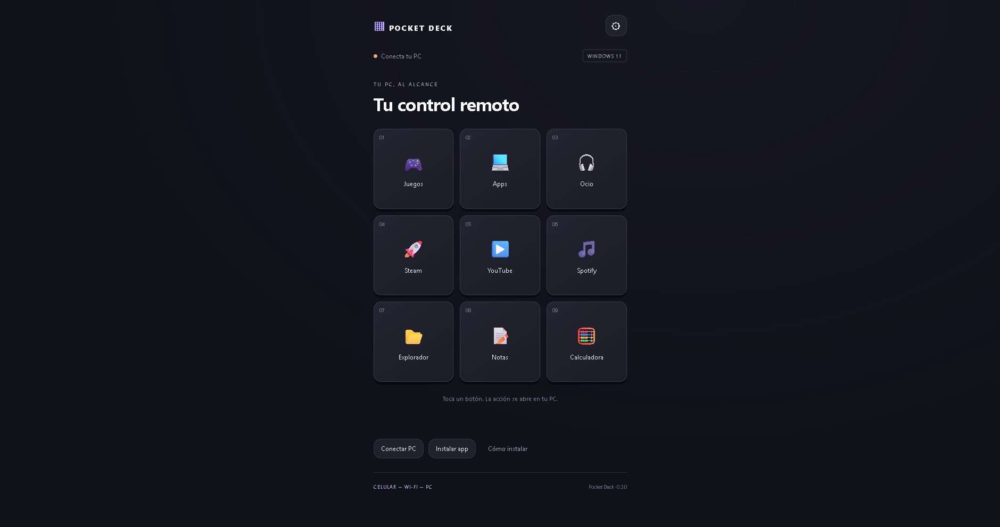

# Pocket Deck · demo y servicio

## Problema que resuelve

Acceder a acciones habituales de una PC desde botones en el celular: aplicaciones, carpetas, enlaces y bibliotecas de juegos.

[Probar la interfaz](https://pocket-deck-oxy.albertovj6969.chatgpt.site/).

La captura corresponde a la PWA publicada, sin una PC vinculada. Puedes explorar su presentación; ejecutar acciones exige instalar el componente de Windows y vincular ambos dispositivos en una red compatible.

## Encargo que puedo preparar

1. Revisar compatibilidad de Windows, navegador móvil y red local.
2. Configurar un panel con los botones acordados.
3. Vincular el celular y comprobar las acciones.
4. Entregar una guía breve y respaldo de la configuración.

La configuración puede organizar aplicaciones de edición, carpetas de trabajo y enlaces habituales. Macros complejas e integraciones adicionales requieren evaluación y cotización separadas. No se promete compatibilidad universal con todos los teléfonos, redes o aplicaciones.

## Tecnología y funcionamiento

JavaScript, Node.js, PWA y aplicación de bandeja en C#. La PWA se aloja por HTTPS; las órdenes se ejecutan en la PC mediante comunicación en la red local. Proyecto personal desarrollado con asistencia de IA.

[Volver al portafolio](README.md).
